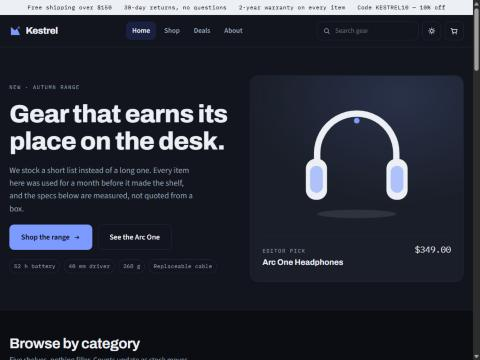

# Kestrel Supply Co.

A responsive e-commerce storefront built with plain HTML, CSS and JavaScript — no framework, no build step, no dependencies. Every product illustration is drawn as inline SVG from the same theme tokens as the UI, so the whole store works in light and dark mode.

**Live demo:** https://ahmadnadeemc.github.io/kestrel-store/



## Features

| Area | What it does |
| --- | --- |
| Catalogue | 14 products across 5 categories, with brands, ratings, stock levels and sale pricing |
| Shop | Filter by category, brand, price and availability; sort by price, rating or newest |
| Search | Live search across name, brand, category and description |
| Product page | Gallery, finish swatches, quantity stepper, spec sheet, tabbed overview / specs / shipping |
| Cart | Slide-out drawer and full cart page, quantity steppers, promo codes (`KESTREL10`), free-shipping threshold, tax and totals |
| Checkout | Contact, shipping and payment steps with validation, then an order confirmation |
| Saved items | Wishlist hearts that persist between visits |
| Theming | Light and dark palettes from CSS custom properties, plus a manual toggle |
| Persistence | Cart, saved items, promo code and theme stored in `localStorage` |
| Accessibility | Keyboard focus states, ARIA roles on tabs, dialog and toggles, `prefers-reduced-motion` support |

## Running it

No build step. Open `index.html` in a browser, or serve the folder:

```bash
python -m http.server 4173
```

Then visit http://localhost:4173.

## Structure

```
index.html              page shell
css/styles.css          design tokens, components, responsive rules
js/data.js              catalogue, pricing rules and the SVG product art
js/app.js               state, views, cart maths, event handling
build-single-file.py    bundles everything into docs/kestrel-single-file.html
docs/                   single-file build and screenshots
```

## Design

- **Type:** Archivo for headings, Source Sans 3 for body, IBM Plex Mono for prices, specs and labels — digits use `tabular-nums` so columns line up.
- **Colour:** a cobalt accent on cool graphite neutrals, with a separate signal colour for sale and low-stock states so semantic colour never collides with the accent.
- **Layout:** a 1240px rail with full-bleed bands, collapsing to a single column at phone width.

## Notes

This is a front-end demo. There is no backend, no payment processing and no real orders — the checkout generates an order number locally and clears the cart.

## Licence

MIT
